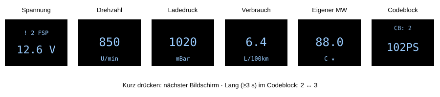
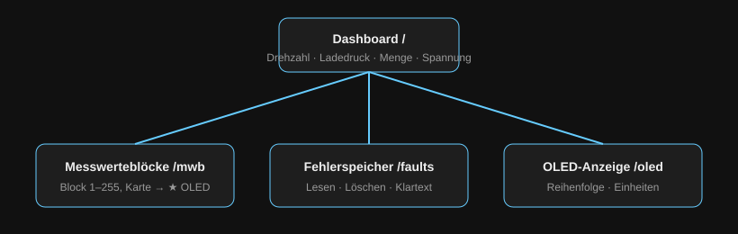

# CodeBlockSwitcherT4_V2 – KWP1281-Diagnose mit ESP32-C3

Ein kompaktes Anzeige- und Diagnosegerät für VAG-Fahrzeuge mit K-Line (KWP1281). Es liest Messwerte aus dem Motorsteuergerät (MSG), zeigt sie auf einem 64×48-OLED an und stellt über einen eigenen WLAN-Hotspot ein Web-Dashboard für das Handy bereit.


---

## Inhalt

1. [Funktionen](#funktionen)
2. [Stückliste](#stückliste)
3. [Schaltung](#schaltung)
4. [Software einrichten](#software-einrichten)
5. [Projektstruktur](#projektstruktur)
6. [Konfiguration](#konfiguration)
7. [Bedienung am Gerät](#bedienung-am-gerät)
8. [Web-Oberfläche](#web-oberfläche)
9. [Technische Details](#technische-details)
10. [Fehlersuche](#fehlersuche)
11. [Sicherheitshinweise](#sicherheitshinweise)

---

## Funktionen

- **Live-Anzeige auf dem OLED:** Bordspannung, Drehzahl, Ladedruck, aktueller Verbrauch, Fahrt-Durchschnitt, Einspritzmenge
- **Eigene Messwerte:** bis zu 4 beliebige Felder aus beliebigen Messwerteblöcken, markiert mit ★
- **Frei konfigurierbare Reihenfolge und Einheiten**, dauerhaft im Flash gespeichert
- **Fehlerspeicher lesen und löschen** mit Klartext, Ursache und Auswirkung
- **Startcheck:** Beim Einschalten wird der Fehlerspeicher einmal gelesen; bei Einträgen zeigt das Spannungsdisplay `! n FSP`
- **Codeblock-Umschaltung** 2 (102 PS) ↔ 3 (138 PS) per langem Tastendruck, WSC bleibt erhalten
- **Web-Dashboard** über eigenen WLAN-Hotspot, ohne Internet und ohne App
- **Testbench-Modus** zum Entwickeln ohne Fahrzeug

---

## Stückliste

| Anzahl | Bauteil | Hinweis |
|---|---|---|
| 1 | ESP32-C3 SuperMini | USB-C, onboard LED an GPIO8 |
| 1 | L9637D | K-Line-Transceiver, SO-8 (ggf. mit Adapterplatine) |
| 1 | OLED 0,66" 64×48, SSD1306, I²C | Adresse 0x3C |
| 1 | Step-Down-Wandler 12 V → 5 V | z. B. MP1584 oder Mini-360, mind. 500 mA |
| 1 | Widerstand 510 Ω | Pull-up K-Line nach +12 V |
| 2 | Widerstände für Spannungsteiler | Verhältnis 47 : 10, siehe unten |
| 1 | Taster (Schließer) | zwischen GPIO9 und GPIO5 |
| 1 | OBD-II-Stecker (männlich) | Pins 4, 5, 7, 16 belegt |
| 1 | Diode 1N4007 (optional) | Verpolschutz in der +12-V-Leitung |
| 1 | Kondensator 100 nF + 10 µF (optional) | Abblockung an VCC des L9637D |
| – | Gehäuse, Litzen, Lochraster | |

---

## Schaltung

### OBD-II-Buchse

| OBD-Pin | Signal |
|---|---|
| 4 / 5 | Masse |
| 7 | K-Line |
| 16 | +12 V Dauerplus |

### Verdrahtung

| Von | Nach | Bemerkung |
|---|---|---|
| OBD 16 (+12 V) | Step-Down IN+, L9637D Pin 6 (VS), Spannungsteiler oben | |
| OBD 4/5 (GND) | Step-Down IN−, gemeinsame Masse | |
| Step-Down OUT+ (5 V) | ESP32 **5V** | |
| OBD 7 (K-Line) | L9637D Pin 5 (K) | 510 Ω von K nach +12 V |
| L9637D Pin 3 (VCC) | ESP32 **3V3** | Logikpegel 3,3 V; Datenblatt prüfen |
| L9637D Pin 4 (GND) | GND | |
| L9637D Pin 8 (TX) | ESP32 **GPIO10** | `KLINE_TX` |
| L9637D Pin 1 (RX) | ESP32 **GPIO1** | `KLINE_RX` |
| L9637D Pin 2 / 7 (LI/LO) | frei | L-Line wird nicht benutzt |
| OLED SDA | ESP32 **GPIO6** | |
| OLED SCL | ESP32 **GPIO7** | |
| OLED VCC / GND | 3V3 / GND | |
| Taster Kontakt 1 | ESP32 **GPIO9** | interner Pull-up |
| Taster Kontakt 2 | ESP32 **GPIO5** | wird per Software auf LOW gelegt |
| Spannungsteiler Mitte | ESP32 **GPIO0** | ADC |

### Spannungsteiler

```
+12 V ──[ R_TOP ]──┬── GPIO0
                   │
                [ R_BOTTOM ]
                   │
                  GND
```

Im Code ist das Verhältnis **47 : 10** hinterlegt (`R_TOP`, `R_BOTTOM`). Bei 16 V am Eingang liegen damit etwa 2,8 V am ADC, also unter 3,3 V. Verwende z. B. 47 kΩ / 10 kΩ und trage deine echten Werte im Code ein. Kleine Abweichungen gleichst du mit `voltageOffset` aus (Multimeter-Vergleich).

> **Hinweis zu GPIO9:** GPIO9 ist beim ESP32-C3 ein Boot-Pin. Wird der Taster beim Einschalten gedrückt, startet der ESP im Download-Modus. Beim normalen Betrieb nicht drücken, während Spannung angelegt wird.

---

## Software einrichten

### 1. Arduino IDE

1. Arduino IDE 2.x installieren.
2. **Datei → Einstellungen → Zusätzliche Boardverwalter-URLs**:
   ```
   https://espressif.github.io/arduino-esp32/package_esp32_index.json
   ```
3. **Boardverwalter** → „esp32 by Espressif Systems“ installieren.

### 2. Bibliotheken

Über **Werkzeuge → Bibliotheken verwalten** installieren:

| Bibliothek | Autor |
|---|---|
| Adafruit SSD1306 | Adafruit |
| Adafruit GFX Library | Adafruit (wird meist automatisch mitinstalliert) |

`WiFi`, `WebServer`, `Wire` und `Preferences` sind im ESP32-Paket enthalten.

> Das 64×48-Display funktioniert mit der normalen Adafruit-SSD1306-Bibliothek, weil Breite und Höhe im Konstruktor übergeben werden.

### 3. Board-Einstellungen

| Einstellung | Wert |
|---|---|
| Board | ESP32C3 Dev Module |
| USB CDC On Boot | **Enabled** (sonst keine Ausgabe im seriellen Monitor) |
| Flash Size | 4MB |
| Partition Scheme | Default 4MB; bei „Sketch too big“: **Huge APP (3MB No OTA)** |
| Upload Speed | 921600 |

### 4. Hochladen

1. ESP per USB-C anschließen.
2. Port wählen.
3. **Hochladen**. Klappt es nicht: BOOT-Taste gedrückt halten, RESET kurz drücken, BOOT loslassen.
4. Serieller Monitor auf **115200 Baud**.

---

## Projektstruktur

Alle Dateien liegen im selben Sketch-Ordner und erscheinen in der IDE als Tabs.

```
CodeblockSwitscherT4_V2/
├── CodeblockSwitscherT4_V2.ino   Logik: K-Line, KWP1281, OLED, Taster, Web-Handler
├── WebPages.h          HTML / CSS / JavaScript der 4 Webseiten
├── FaultTable.h        Fehlercodes mit Text, OBD-Code, Ursache, Auswirkung
└── MwbTable.h          Titel und Feldnamen der Messwerteblöcke
```

`FaultTable.h` muss `FAULT_TABLE[]` (Felder `obd`, `text`, `cause`, `effect`) und `findFaultIndex(code)` bereitstellen. `MwbTable.h` stellt `MWB_TABLE[]` (Felder `title`, `cond`, `f[4].name`, `f[4].unit`) und `findMwbIndex(group)` bereit. `MwbTable.h` wird nach `jsonEscape()` eingebunden.

---

## Konfiguration

Wichtige Konstanten am Anfang der `.ino`:

| Konstante | Standard | Bedeutung |
|---|---|---|
| `TESTBENCH_MODE` | `0` | `1` = Fahrzeug wird simuliert |
| `MSG_ADDRESS` | `0x01` | Adresse Motorsteuergerät |
| `KLINE_BAUD` | `9600` | Baudrate nach Init (ggf. 10400) |
| `AP_SSID` / `AP_PASS` | `TDI-Dashboard` / `12345678` | WLAN-Hotspot – **Passwort ändern!** |
| `BUTTON_LONG_PRESS_MS` | `3000` | Dauer langer Tastendruck |
| `MEASUREMENT_INTERVAL_MS` | `500` | Messintervall |
| `R_TOP`, `R_BOTTOM`, `voltageOffset` | 47:10, −1,24 | Spannungsmessung kalibrieren |
| `INJECTIONS_PER_REV` | `2.5` | 5-Zylinder; 4-Zyl. = 2.0 |

Die Verbrauchsberechnung setzt Einspritzmenge (MWB 1 Feld 2), Drehzahl (MWB 1 Feld 1) und Geschwindigkeit (MWB 6 Feld 1) voraus. Ladedruck kommt aus MWB 11 Feld 3. Bei anderen Motoren die Blöcke anpassen.

---

## Bedienung am Gerät



| Aktion | Wirkung |
|---|---|
| Kurz drücken | nächster Bildschirm laut Reihenfolge |
| Nach dem letzten Bildschirm | Codeblock-Anzeige (`CB: 2 / 102PS`) |
| Kurz drücken im Codeblock | zurück zum ersten Bildschirm |
| Lang drücken (≥ 3 s) im Codeblock | Codierung 2 ↔ 3 schreiben |

Beim Start erscheint das VW-Logo, danach der erste Bildschirm der gespeicherten Liste. Im Spannungsmodus ist die K-Line frei, solange die Webseite nicht offen ist.

---

## Web-Oberfläche



1. Mit dem WLAN **TDI-Dashboard** verbinden.
2. Im Browser **http://192.168.4.1** öffnen.
3. Android meldet „kein Internet“ – Verbindung trotzdem beibehalten und mobile Daten ggf. kurz ausschalten.

| Seite | Inhalt |
|---|---|
| `/` Dashboard | Drehzahl, Ladedruck, Einspritzmenge, Spannung live |
| `/mwb` Messwerteblöcke | Block 1–255 wählen; Karte antippen → als ★ eigener Messwert aufs OLED |
| `/faults` Fehlerspeicher | Lesen, Löschen, Klartext mit Ursache und Auswirkung |
| `/oled` OLED-Anzeige | Reihenfolge ▲▼, ausblenden ✕, Einheit ✎, eigene Messwerte 🗑 |

Änderungen an Einheiten und eigenen Messwerten werden sofort gespeichert. Die Reihenfolge erst mit **„Reihenfolge speichern“**. Alles bleibt nach einem Neustart erhalten (Preferences-Namespace `oled`).

### API

| Methode | Pfad | Funktion |
|---|---|---|
| GET | `/api/live` | Livewerte als JSON |
| GET | `/api/mwb?group=n` | Messwerteblock |
| GET | `/api/faults` | Fehlerspeicher-Status |
| POST | `/api/faults/read`, `/api/faults/clear` | Lesen / Löschen anstoßen |
| GET | `/api/oled` | OLED-Konfiguration |
| POST | `/api/oled/save?list=0,1,10` | Reihenfolge |
| POST | `/api/oled/custom?g=&f=&title=&unit=` | eigenen Messwert anlegen |
| POST | `/api/oled/delete?slot=` | eigenen Messwert löschen |
| POST | `/api/oled/unit?id=&n=` | Einheit ändern |

---

## Technische Details

### KWP1281-Ablauf

1. 5-Baud-Init der Adresse `0x01` (10 Bit à 200 ms)
2. MSG antwortet `55 01 8A`, Tester sendet Komplement `75`
3. Identifikationsblöcke empfangen und mit `09` (ACK) bestätigen; der Codierblock liefert Codierung und WSC
4. Danach ist der Tester Master

| Block | Titel | Funktion |
|---|---|---|
| `03 ZZ 09 03` | 0x09 | Acknowledge |
| `03 ZZ 06 03` | 0x06 | Ende |
| `04 ZZ 29 GG 03` | 0x29 | Messwerteblock lesen → Antwort 0xE7 |
| `03 ZZ 07 03` | 0x07 | Fehlerspeicher lesen → Antwort 0xFC |
| `03 ZZ 05 03` | 0x05 | Fehlerspeicher löschen |
| `07 ZZ 10 PP0..PP3 03` | 0x10 | Codierung schreiben |

Jedes gesendete Byte erzeugt ein Echo, das verworfen wird; jedes Byte außer ETX (`03`) wird vom Gegenüber komplementiert. Messwerte werden über 70 Kennzahlen (`decodeKwpValue`) umgerechnet.

### Verbrauch

$$\text{L/h} = \frac{\text{mg/Hub} \cdot \text{U/min} \cdot 2{,}5 \cdot 60}{832\,000}$$

$$\text{L/100km} = \frac{\text{L/h} \cdot 100}{\text{km/h}}$$

Der aktuelle Wert wird über 35 Werte geglättet und unter 10 km/h als 0,0 angezeigt. Der Durchschnitt summiert Liter und Kilometer ab 4 km/h und wird ab 100 m angezeigt. Er liegt nur im RAM.

### Speicher

| Schlüssel | Inhalt |
|---|---|
| `list` | Reihenfolge der Bildschirme |
| `custom` | 4 eigene Messwerte (Block, Feld, Titel, Einheit) |
| `units` | Einheiten der 6 festen Bildschirme |

Ändert sich die Struktur `CustomScreen`, werden alte eigene Messwerte nach dem Flashen verworfen und müssen neu angelegt werden.

---

## Fehlersuche

| Problem | Ursache / Lösung |
|---|---|
| Keine Ausgabe im seriellen Monitor | „USB CDC On Boot: Enabled“ setzen |
| `Kein Synchronisationsbyte` | Zündung an? K-Line an OBD 7? 510-Ω-Pull-up? Masse gemeinsam? |
| `Erwartetes Keyword 01 8A fehlt` | anderes Protokoll (KWP2000/CAN) – nicht unterstützt |
| Echo-Warnungen | TX/RX vertauscht oder VCC am L9637D fehlt |
| Blockzähler-Fehler | Timing; `TESTER_RESPONSE_DELAY_MS` leicht erhöhen |
| WLAN instabil | `WIFI_POWER_8_5dBm` beibehalten, Antenne frei halten |
| ESP startet nicht | Taster (GPIO9) beim Einschalten gedrückt |
| Spannung falsch | Widerstände im Code anpassen, `voltageOffset` kalibrieren |
| `'..._HTML' was not declared` | `WebPages.h` fehlt im Sketch-Ordner |
| „Sketch too big“ | Partition „Huge APP“ wählen |

Zum Testen ohne Auto: `#define TESTBENCH_MODE 1`.

---

## Sicherheitshinweise

- **Codierung schreiben** verändert das Steuergerät. Vorher die Originalcodierung notieren. Nur Codierungen schreiben, die für Motor und Getriebe zulässig sind.
- Leistungsänderungen können Betriebserlaubnis, Versicherung und Garantie betreffen.
- Gerät nicht während der Fahrt bedienen.
- OBD-Pin 16 führt Dauerplus: Gerät beim Abstellen abziehen oder Ruhestrom beachten.
- Fehlerspeicher löschen beseitigt keine Ursache.
- Nutzung auf eigene Verantwortung.
