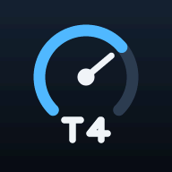
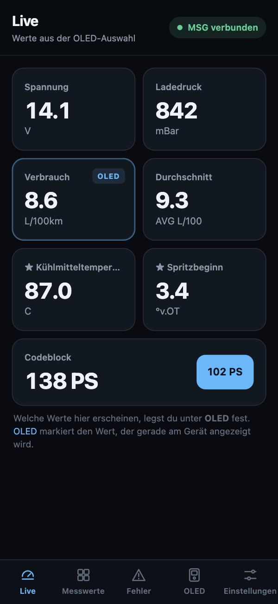
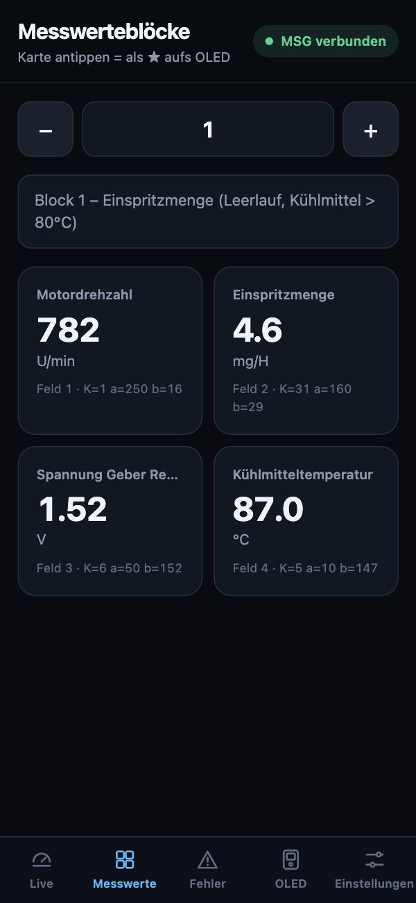
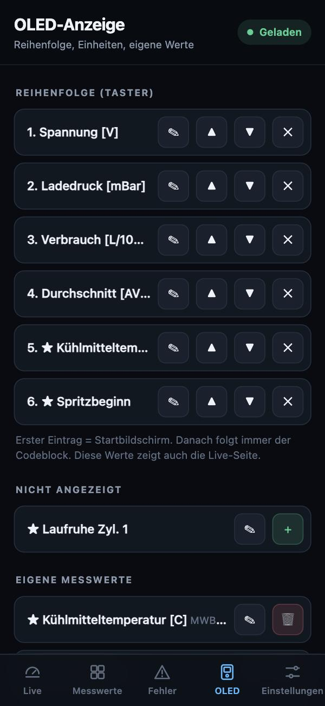
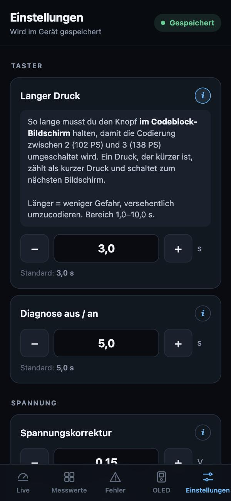
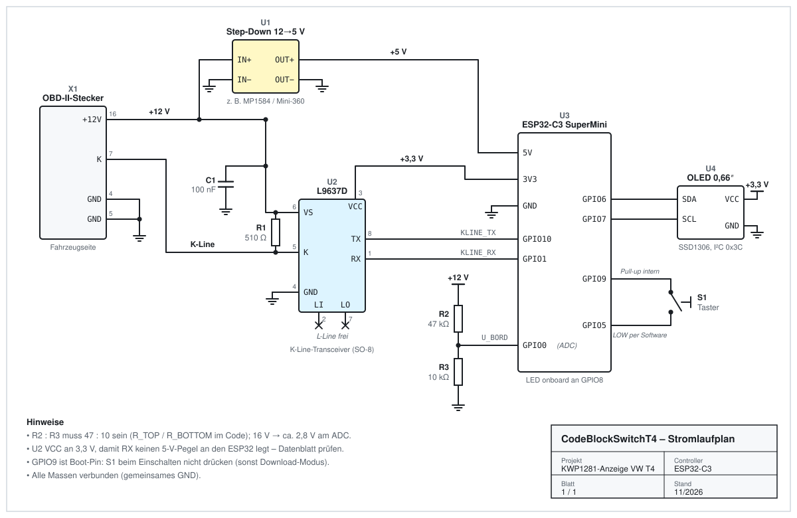
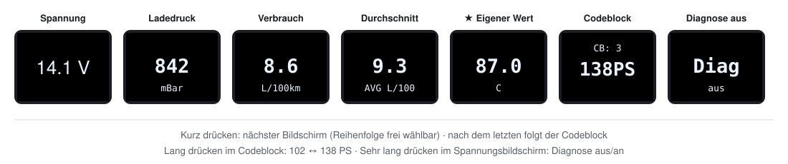
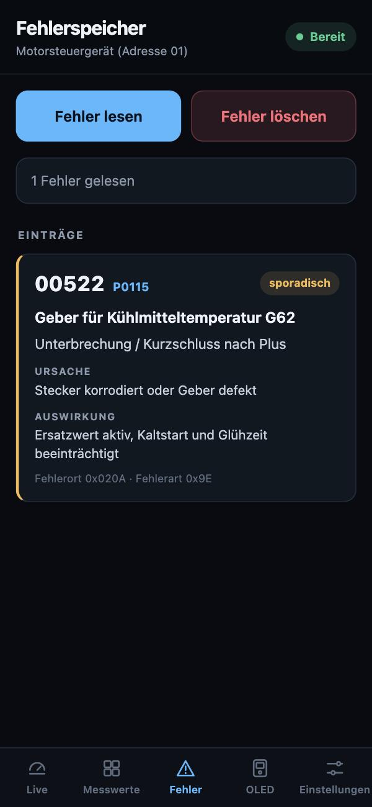

<p align="center">
  
</p>

<h1 align="center">CodeBlockSwitchT4</h1>

<p align="center">
  <b>Kleines OBD-Gerät für den VW T4 TDI: Live-Messwerte auf dem OLED und dem Handy,<br>
  Fehlerspeicher im Klartext und Codeblock-Umschaltung 102 ↔ 138 PS.</b><br>
  ESP32-C3 · K-Line (KWP1281) · eigener WLAN-Hotspot · keine App, kein Internet nötig
</p>

> [!IMPORTANT]
> **Die Leistungsänderung funktioniert nur mit einer angepassten Motorsoftware.** Das Gerät schaltet lediglich die Codierung des Motorsteuergeräts zwischen 2 und 3 um. Mehr Leistung gibt es nur, wenn auf dem Steuergerät eine Software läuft, die für beide Codierungen ein eigenes Kennfeld hat. Mit der Serien-Software ändert sich an der Leistung nichts.

<p align="center">
  
  
  
  
</p>

---

## Inhalt

1. [Was das Gerät kann](#was-das-gerät-kann)
2. [Voll modular: jeder Messwert](#voll-modular-jeder-messwert)
3. [Materialliste](#materialliste)
4. [Stromlaufplan](#stromlaufplan)
5. [Software aufspielen](#software-aufspielen)
6. [Bedienung am Gerät](#bedienung-am-gerät)
7. [WebApp](#webapp)
8. [Einstellungen im Code](#einstellungen-im-code)
9. [Technische Details](#technische-details)
10. [Fehlersuche](#fehlersuche)
11. [Sicherheitshinweise](#sicherheitshinweise)

---

## Was das Gerät kann

Der CodeBlockSwitchT4 steckt in der OBD-Buchse, spricht über die K-Line mit dem Motorsteuergerät (KWP1281) und zeigt die Werte auf einem kleinen OLED an. Gleichzeitig öffnet er einen eigenen WLAN-Hotspot, über den du im Browser deines Handys alles siehst und einstellst.

| | |
|---|---|
| 📟 **OLED-Anzeige** | Bordspannung, Ladedruck, aktueller Verbrauch, Fahrt-Durchschnitt und beliebig viele eigene Messwerte, per Taster durchschalten |
| 📱 **WebApp** | Alle ausgewählten Werte live auf dem Handy, dazu Messwerteblöcke, Fehlerspeicher, OLED-Konfiguration und Einstellungen |
| 🧩 **Voll modular** | Jedes Feld aus jedem Messwerteblock (1–255) lässt sich als eigener Wert auf OLED und Handy legen |
| ⚡ **Codeblock 2 ↔ 3** | 102 PS ↔ 138 PS per langem Tastendruck oder in der WebApp, der WSC bleibt erhalten – **nur mit angepasster Motorsoftware** |
| 🔧 **Fehlerspeicher** | Lesen und Löschen mit Klartext, Ursache und Auswirkung; beim Start automatischer Check (`! n FSP`) |
| ⛽ **Verbrauch** | Aktueller Verbrauch in L/100 km und Fahrt-Durchschnitt, berechnet aus Einspritzmenge, Drehzahl und Geschwindigkeit |
| 🔌 **Diagnose aus** | K-Line auf Knopfdruck freigeben, z. B. für VCDS, ohne das Gerät abzuziehen |
| 💾 **Alles gespeichert** | Bildschirme, Einheiten, eigene Werte und Einstellungen bleiben nach dem Ausschalten erhalten |

---

## Voll modular: jeder Messwert

Das Gerät ist nicht auf fest einprogrammierte Werte beschränkt. **Jeder Messwert, den das Motorsteuergerät liefert, kann zur Anzeige werden**, ganz ohne Code-Änderung:

1. In der WebApp unter **Messwerte** einen Block wählen (1–255). Das Gerät liest alle vier Felder live und rechnet sie mit der passenden Einheit um.
2. Auf die gewünschte Karte tippen und bestätigen. Der Wert erscheint als **★ eigener Messwert**.
3. Er ist sofort auf dem OLED (Taster) **und** auf der Live-Seite im Handy zu sehen.
4. Unter **OLED** kannst du ihm eine kurze Bezeichnung geben (✎), ihn verschieben (▲▼), ausblenden (✕) oder löschen (🗑).

| Was | Wie viel |
|---|---|
| Eigene Messwerte | bis zu **8** |
| Bildschirme in der Reihenfolge | bis zu **12** (plus Codeblock) |
| Feste Bildschirme | Spannung, Ladedruck, Verbrauch, Durchschnitt |
| Umrechnungen | 70 KWP1281-Kennzahlen (Temperatur, Druck, Winkel, Spannung, Text …) |
| Hinterlegte Blöcke | 16 Blöcke mit Titel und Feldnamen, 62 Fehlercodes mit Klartext |

Drehzahl oder Einspritzmenge stehen deshalb nicht als feste Bildschirme bereit: Sie sind einfach eigene Messwerte aus Block 1.

---

## Materialliste

| Anzahl | Bauteil | Hinweis |
|---|---|---|
| 1 | ESP32-C3 SuperMini | USB-C, LED an GPIO8 |
| 1 | L9637D | K-Line-Transceiver, SO-8 (ggf. auf Adapterplatine) |
| 1 | OLED 0,66″ 64×48, SSD1306, I²C | Adresse `0x3C` |
| 1 | Step-Down-Wandler 12 V → 5 V | z. B. MP1584 oder Mini-360, mind. 500 mA |
| 1 | Widerstand 510 Ω (R1) | K-Line-Pull-up zwischen K (Pin 5) und VS (Pin 6) des L9637D |
| 1 | Kondensator 100 nF (C1) | zwischen VS (Pin 6) und GND des L9637D |
| 1 | Widerstand 47 kΩ (R2) | Spannungsteiler oben |
| 1 | Widerstand 10 kΩ (R3) | Spannungsteiler unten |
| 1 | Taster, Schließer (S1) | zwischen GPIO9 und GPIO5 |
| 1 | OBD-II-Stecker (männlich) | Pins 4, 5, 7, 16 belegt |
| 1 | Gehäuse | 3D-Druck: [`T4 Codeblock Switcher.stl`](T4%20Codeblock%20Switcher.stl) |
| – | Litze, Lochraster, Schrumpfschlauch | |

---

## Stromlaufplan



### Verdrahtung

| Von | Nach | Bemerkung |
|---|---|---|
| OBD 16 (+12 V Dauerplus) | Step-Down IN+, L9637D VS (Pin 6), R2 | |
| OBD 4 / 5 (Masse) | gemeinsame Masse | |
| Step-Down OUT+ (5 V) | ESP32 **5V** | |
| OBD 7 (K-Line) | L9637D K (Pin 5) | R1 510 Ω zwischen K und VS |
| L9637D VS (Pin 6) | GND | C1 100 nF |
| L9637D VCC (Pin 3) | ESP32 **3V3** | 3,3-V-Pegel für den ESP32 |
| L9637D GND (Pin 4) | GND | |
| L9637D TX (Pin 8) | ESP32 **GPIO10** | `KLINE_TX` |
| L9637D RX (Pin 1) | ESP32 **GPIO1** | `KLINE_RX` |
| L9637D LI / LO (Pin 2 / 7) | frei | L-Line wird nicht benutzt |
| OLED SDA / SCL | ESP32 **GPIO6** / **GPIO7** | |
| OLED VCC / GND | 3V3 / GND | |
| Taster | ESP32 **GPIO9** ↔ **GPIO5** | GPIO9 mit internem Pull-up, GPIO5 per Software auf LOW |
| Mitte R2 / R3 | ESP32 **GPIO0** | Bordspannung (ADC) |

**Spannungsteiler:** Im Code ist das Verhältnis 47 : 10 hinterlegt (`R_TOP`, `R_BOTTOM`). Bei 16 V liegen so etwa 2,8 V am ADC. Kleine Abweichungen gleichst du in der WebApp mit der **Spannungskorrektur** aus.

> **GPIO9 ist ein Boot-Pin.** Wird der Taster beim Einschalten gedrückt, startet der ESP32 im Download-Modus und das Programm läuft nicht.

---

## Software aufspielen

### 1. Arduino IDE vorbereiten

1. Arduino IDE 2.x installieren.
2. **Datei → Einstellungen → Zusätzliche Boardverwalter-URLs**:
   ```
   https://espressif.github.io/arduino-esp32/package_esp32_index.json
   ```
3. Im **Boardverwalter** „esp32 by Espressif Systems“ installieren.
4. Unter **Werkzeuge → Bibliotheken verwalten** installieren:
   - **Adafruit SSD1306**
   - **Adafruit GFX Library** (kommt meist automatisch mit)

`WiFi`, `WebServer`, `Wire` und `Preferences` sind im ESP32-Paket enthalten.

### 2. Board-Einstellungen

| Einstellung | Wert |
|---|---|
| Board | ESP32C3 Dev Module |
| USB CDC On Boot | **Enabled** (sonst keine Ausgabe im seriellen Monitor) |
| Flash Size | 4MB |
| Partition Scheme | Default 4MB (bei „Sketch too big“: Huge APP) |
| Upload Speed | 921600 |

### 3. Vor dem ersten Flashen

**WLAN-Passwort ändern!** Über die WebApp lässt sich der Codeblock des Steuergeräts schreiben. In `CodeBlockSwitchT4.ino`:

```cpp
const char* AP_SSID = "CodeBlockSwitchT4";
const char* AP_PASS = "12345678";   // mind. 8 Zeichen – unbedingt ändern
```

### 4. Hochladen

1. Den Ordner `CodeBlockSwitchT4` öffnen (der Ordnername muss zum `.ino`-Namen passen).
2. ESP32 per USB-C anschließen, Port wählen, **Hochladen**.
3. Klappt es nicht: BOOT gedrückt halten, RESET kurz drücken, BOOT loslassen.
4. Serieller Monitor: **115200 Baud**.

---

## Bedienung am Gerät



| Aktion | Wirkung |
|---|---|
| Kurz drücken | nächster Bildschirm laut Reihenfolge |
| Nach dem letzten Bildschirm | Codeblock-Anzeige (`CB: 3 / 138PS`) |
| Kurz drücken im Codeblock | zurück zum ersten Bildschirm |
| Lang drücken im Codeblock (Std. 3 s) | Codeblock 2 ↔ 3 schreiben |
| Sehr lang drücken im Spannungsbildschirm (Std. 5 s) | Diagnose aus ↔ an |

Beim Einschalten erscheint das Startlogo, dann wird einmal der Fehlerspeicher gelesen. Findet das Gerät Einträge, zeigt der Spannungsbildschirm kurz `! n FSP`.

**Diagnose aus (z. B. für VCDS):** Im Spannungsbildschirm sehr lang drücken. Das Gerät beendet die Verbindung sauber, zeigt `Diag aus` und lässt die K-Line komplett frei. Bildschirmwechsel, Codeblock und Fehlerspeicher sind dann gesperrt. Der Zustand bleibt auch nach einem Neustart erhalten. Erneut sehr lang drücken schaltet die Diagnose wieder ein; vorher das andere Diagnosegerät abziehen.

---

## WebApp

### Verbinden

1. Zündung an – das Gerät startet und öffnet den Hotspot.
2. Am Handy mit dem WLAN **CodeBlockSwitchT4** verbinden (Passwort aus dem Code).
3. Im Browser **http://192.168.4.1** öffnen.
4. Android meldet „kein Internet“: Verbindung trotzdem behalten, ggf. mobile Daten kurz ausschalten.

**Als App auf den Startbildschirm legen:**

- **iPhone:** in Safari **Teilen → Zum Home-Bildschirm** – startet danach als „T4“ im Vollbild mit eigenem Icon.
- **Android:** in Chrome **⋮ → Zum Startbildschirm hinzufügen**.

### Seiten

<table>
<tr>
<td width="210"></td>
<td>

**Live**

Zeigt genau die Werte, die unter **OLED** ausgewählt sind – in derselben Reihenfolge und mit deinen Bezeichnungen. Der Wert, der gerade am Gerät zu sehen ist, ist blau markiert.

Darunter steht der aktive **Codeblock** (102 PS / 138 PS) mit einem Knopf zum Umschalten. Nach dem Schreiben erscheint **„Bitte Zündungswechsel durchführen“** – die neue Leistung ist erst nach Zündung aus/an aktiv. Eine Leistungsänderung gibt es nur mit angepasster Motorsoftware.

</td>
</tr>
<tr>
<td></td>
<td>

**Messwerte**

Blättert durch alle Messwerteblöcke 1–255. Jede Karte zeigt Feldname, Wert und Einheit sowie die Rohdaten (Kennzahl, a, b).

**Karte antippen** → der Wert wird zum eigenen Messwert für OLED und Live-Seite.

</td>
</tr>
<tr>
<td></td>
<td>

**OLED**

Legt fest, was am Gerät und auf der Live-Seite angezeigt wird:

- ▲ ▼ Reihenfolge (erster Eintrag = Startbildschirm)
- ✕ ausblenden, **+** wieder anzeigen
- ✎ Bezeichnung / Einheit fürs OLED (max. 9 Zeichen)
- 🗑 eigenen Messwert löschen

Die Reihenfolge wird mit **„Reihenfolge speichern“** übernommen, alles andere sofort.

</td>
</tr>
<tr>
<td></td>
<td>

**Einstellungen**

Jede Einstellung hat ein **ⓘ** mit Erklärung.

| Einstellung | Standard | Bereich |
|---|---|---|
| Langer Druck (Codeblock) | 3,0 s | 1,0–10,0 s |
| Diagnose aus / an | 5,0 s | 2,0–20,0 s, mind. 1 s länger als der lange Druck |
| Spannungskorrektur | 0,00 V | −3,00 bis +3,00 V |

Bei der Spannungskorrektur zeigt die Seite die gerade gemessene Spannung an – einfach mit einem Multimeter an der Batterie vergleichen.

</td>
</tr>
<tr>
<td></td>
<td>

**Fehler**

Fehlerspeicher des Motorsteuergeräts lesen und löschen. Bekannte Fehlercodes erscheinen mit OBD-Code, Klartext, Ursache und Auswirkung; sporadische Fehler sind gelb markiert.

</td>
</tr>
</table>

<sub>Screenshots mit Beispielwerten.</sub>

---

## Einstellungen im Code

Was sich nicht in der WebApp einstellen lässt, steht in `CodeBlockSwitchT4.ino` – die meisten Konstanten ganz oben, die Verbrauchswerte in `calculateLitersPerHour()`:

| Konstante | Standard | Bedeutung |
|---|---|---|
| `AP_SSID` / `AP_PASS` | `CodeBlockSwitchT4` / `12345678` | WLAN-Hotspot – **Passwort ändern!** |
| `TESTBENCH_MODE` | `0` | `1` = Fahrzeug wird simuliert (Entwickeln am Schreibtisch) |
| `R_TOP` / `R_BOTTOM` | 47 : 10 | Verhältnis des Spannungsteilers |
| `INJECTIONS_PER_REV` | `2.5` | Einspritzungen pro Umdrehung (5-Zylinder; 4-Zylinder = 2.0) |
| `DIESEL_DENSITY_MG_PER_L` | `832000` | Dieseldichte – zum Kalibrieren des Verbrauchs |
| `FUEL_AVG_SAMPLES` | `35` | Glättung des aktuellen Verbrauchs |
| `MEASUREMENT_INTERVAL_MS` | `500` | Messintervall |
| `DEFAULT_LONG_PRESS_MS` u. a. | – | Standardwerte der WebApp-Einstellungen |
| Pins (`KLINE_TX`, `OLED_SDA` …) | siehe Stromlaufplan | nur bei anderer Verdrahtung ändern |

Die KWP1281-Zeiten (`FIVE_BAUD_BIT_US`, Timeouts, `KWP_KEEPALIVE_MS`) und `MSG_ADDRESS` kommen aus dem Protokoll und sollten nicht verändert werden.

---

## Technische Details

### Projektstruktur

```
CodeBlockSwitchT4/
├── CodeBlockSwitchT4.ino        Logik: K-Line, KWP1281, OLED, Taster, Webserver
├── WebPages.h                   HTML / CSS / JavaScript der WebApp
├── AppIcon.h                    App-Icon als Byte-Array
├── FaultTable.h                 Fehlercodes mit Klartext, Ursache, Auswirkung
├── MwbTable.h                   Titel und Feldnamen der Messwerteblöcke
├── T4 Codeblock Switcher.stl    Gehäuse (3D-Druck)
└── images/                      Stromlaufplan, Icon, Screenshots
```

### KWP1281-Ablauf

1. 5-Baud-Init auf Adresse `0x01` (Motorsteuergerät)
2. Steuergerät antwortet `55 01 8A`, Tester sendet das Komplement
3. Identifikationsblöcke werden gelesen; der Codierblock liefert Codierung und WSC
4. Danach fragt das Gerät Messwerteblöcke ab (`0x29`) und hält die Verbindung mit Keep-Alive offen

| Block | Funktion |
|---|---|
| `0x09` | Acknowledge / Keep-Alive |
| `0x06` | Verbindung beenden |
| `0x29` | Messwerteblock lesen → Antwort `0xE7` |
| `0x07` | Fehlerspeicher lesen → Antwort `0xFC` |
| `0x05` | Fehlerspeicher löschen |
| `0x10` | Codierung schreiben (Codeblock), danach wird zur Kontrolle zurückgelesen |

### Woher die Werte kommen

| Wert | Quelle |
|---|---|
| Drehzahl, Einspritzmenge | MWB 1, Feld 1 und 2 |
| Geschwindigkeit | MWB 6, Feld 1 |
| Ladedruck (Überdruck) | MWB 10, Feld 3 − Feld 2 |
| Bordspannung | eigener ADC am Spannungsteiler |
| Eigene Messwerte | beliebiger Block / Feld |

Ist die WebApp offen, liest das Gerät alle Werte der OLED-Liste; eigene Messwerte werden reihum aktualisiert (ein Block pro Messzyklus).

### Verbrauch

$$\text{L/h} = \frac{\text{mg/Hub} \cdot \text{U/min} \cdot 2{,}5 \cdot 60}{832\,000}
\qquad
\text{L/100km} = \frac{\text{L/h} \cdot 100}{\text{km/h}}$$

Der aktuelle Verbrauch wird über 35 Werte geglättet und unter 10 km/h als 0,0 angezeigt. Der Fahrt-Durchschnitt zählt in **jedem** Bildschirm mit (ab 4 km/h, Anzeige ab 100 m Strecke) und beginnt nach jedem Neustart bei 0.

### Gespeicherte Daten (Flash)

| Bereich | Inhalt |
|---|---|
| `oled` | Reihenfolge der Bildschirme, eigene Messwerte, Einheiten |
| `cfg` | Einstellungen aus der WebApp |
| `diag` | Diagnose aus / an |

### API

| Methode | Pfad | Funktion |
|---|---|---|
| GET | `/api/live` | Werte aller ausgewählten Bildschirme, Codeblock, Status |
| GET | `/api/mwb?group=n` | Messwerteblock lesen |
| GET | `/api/faults` | Status Fehlerspeicher |
| POST | `/api/faults/read` · `/api/faults/clear` | Lesen / Löschen anstoßen |
| GET | `/api/oled` | OLED-Konfiguration |
| POST | `/api/oled/save?list=0,2,10` | Reihenfolge speichern |
| POST | `/api/oled/custom?g=&f=&title=&unit=` | eigenen Messwert anlegen |
| POST | `/api/oled/delete?slot=` | eigenen Messwert löschen |
| POST | `/api/oled/unit?id=&n=` | Bezeichnung / Einheit ändern |
| GET | `/api/settings` | Einstellungen lesen |
| POST | `/api/settings/save?lp=&dp=&vo=` | Einstellungen speichern |
| POST | `/api/codeblock?to=2\|3` | Codeblock schreiben |
| POST | `/api/codeblock/ack` | Meldung „Zündungswechsel“ bestätigen |

---

## Fehlersuche

| Problem | Ursache / Lösung |
|---|---|
| Keine Ausgabe im seriellen Monitor | „USB CDC On Boot: Enabled“ setzen |
| Arduino IDE öffnet den Sketch nicht | Ordnername und `.ino`-Name müssen gleich sein |
| `Kein Synchronisationsbyte` | Zündung an? K-Line an OBD 7? R1 (510 Ω) vorhanden? Gemeinsame Masse? |
| `Erwartetes Keyword 01 8A fehlt` | Steuergerät spricht kein KWP1281 (z. B. KWP2000 / CAN) |
| Echo-Warnungen | TX/RX vertauscht oder VCC am L9637D fehlt |
| WebApp lädt nicht | Mit dem WLAN des Geräts verbunden? Mobile Daten aus? Adresse `http://192.168.4.1` |
| WLAN instabil | Sendeleistung ist bewusst reduziert; Antenne des ESP32 frei halten |
| ESP32 startet nicht | Taster (GPIO9) beim Einschalten gedrückt |
| Spannung weicht ab | In der WebApp unter Einstellungen die Spannungskorrektur anpassen |
| Codeblock schreiben schlägt fehl | Zündung an? Diagnose an? Ein anderes Diagnosegerät gleichzeitig angeschlossen? |
| „Sketch too big“ | Partition „Huge APP“ wählen |

Zum Testen ohne Fahrzeug: `#define TESTBENCH_MODE 1`.

---

## Sicherheitshinweise

- **Codeblock schreiben verändert das Steuergerät.** Vorher die Originalcodierung notieren und nur Codierungen schreiben, die zu Motor und Getriebe passen.
- **Mehr Leistung nur mit angepasster Motorsoftware:** Der Codeblock wählt nur zwischen zwei Kennfeldern, die die Software auf dem Steuergerät bereitstellen muss. Mit der Serien-Software bewirkt die Umschaltung keine Leistungsänderung.
- Der Codeblock lässt sich in der WebApp auch während der Fahrt umschalten. Bedienung nur durch den Beifahrer; die neue Leistung ist erst nach einem Zündungswechsel im Stand aktiv.
- **WLAN-Passwort ändern** – sonst kann jeder in Funkreichweite den Codeblock ändern oder den Fehlerspeicher löschen.
- Leistungsänderungen können Betriebserlaubnis, Versicherung und Garantie betreffen.
- OBD-Pin 16 führt Dauerplus: Gerät bei längerer Standzeit abziehen.
- Fehlerspeicher löschen beseitigt nicht die Ursache.
- Nutzung auf eigene Verantwortung.
